# 前列腺癌随访与科研数据库

> **Prostate Cancer Follow-up & Research Database**
> 面向泌尿外科 / 肿瘤科的**单病种科研数据平台**：从初诊、根治手术、放疗、内分泌治疗，到多线换药、随访预警、CRPC 判定与结局统计，把日常诊疗沉淀为可检索、可统计、可复用的研究队列。

[](LICENSE)
[](https://nodejs.org)
[](#9-测试)
[](CONTRIBUTING.md)

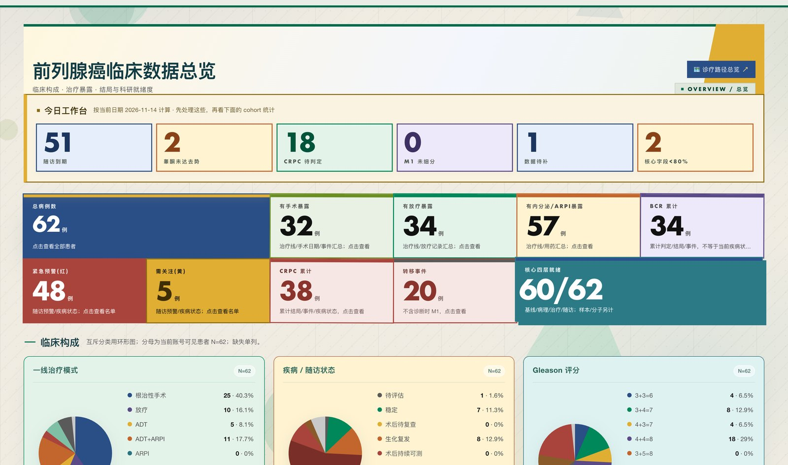

---

## ⚠️ 使用前必读

1. **本项目不是医疗器械**，未经过任何临床验证，**不构成医疗建议**，不得直接用于诊疗决策。所有自动判定（BCR / CRPC / 风险分层 / 随访到期）仅供科研与临床参考，最终决策以医生判断为准。
2. **严禁向本仓库提交任何真实患者数据**。仓库内所有示例与截图均为构造的测试数据；`.gitignore` 已排除 `data/`、`uploads/` 与数据库导出文件，请勿用 `-f` 强行加入。
3. 若用于真实临床环境，请自行完成：伦理审批、数据脱敏、等保/个人信息保护合规评估、访问审计与备份加密。

---

## 目录

- [1. 为什么做这个项目](#1-为什么做这个项目)
- [2. 界面一览](#2-界面一览)
- [3. 功能](#3-功能)
- [4. 技术栈](#4-技术栈)
- [5. 快速开始](#5-快速开始)
- [6. 环境变量](#6-环境变量)
- [7. 目录结构](#7-目录结构)
- [8. 数据模型与文档](#8-数据模型与文档)
- [9. 测试](#9-测试)
- [10. 部署](#10-部署)
- [11. 贡献](#11-贡献)
- [12. 作者与许可](#12-作者与许可)

---

## 1. 为什么做这个项目

前列腺癌的随访周期长、节点多：PSA 复查、睾酮监测、影像评估、去势抵抗（CRPC）判定、转移灶记录、多线治疗切换…… 通用电子病历系统通常不覆盖这些**结构化随访字段**，而科研又要求字段口径统一、可导出、可复核。

本项目尝试解决三件事：

1. **把随访结构化** —— 用固定的访视模板、检验项目字典和判定规则，让每次随访落到可查询的字段，而不是散落在病程记录的自由文本里。
2. **让数据质量可见** —— 总览页直接暴露「待补字段」「M1 未细分」「CRPC 待判定」「失访」等缺口，把补录变成日常动作。
3. **降低录入成本** —— 可选的 AI 病历登记：上传出院小结/病理报告，模型抽取结构化字段，医生逐条审核后入库（也支持完全离线演练）。

**三态语义贯穿全库**：`NULL` = 未评估、`0` = 评估为否、`1` = 是。「未评估」绝不当作「阴性」参与统计——这是科研数据可信的底线。

## 2. 界面一览

界面采用「松绿构成」视觉语言：瑞士国际主义的网格秩序 × 构成主义的色块张力。直角硬边、原色平涂、编号索引、可见基线网格；主色松绿 `#00694B`，砖红只保留给临床警示语义（高危 / CRPC / 转移 / 逾期 / 错误）。

### 登录与总览

| 登录 | 临床构成与科研就绪度 |
|---|---|
| 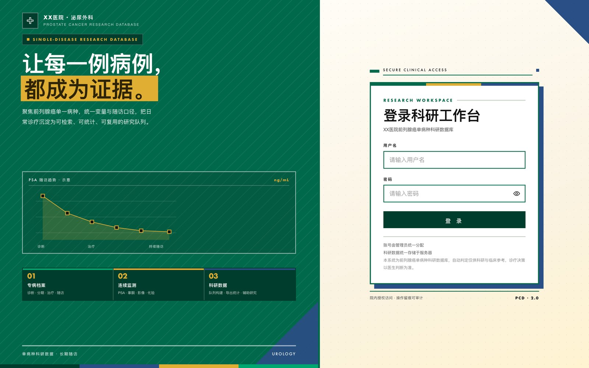 | 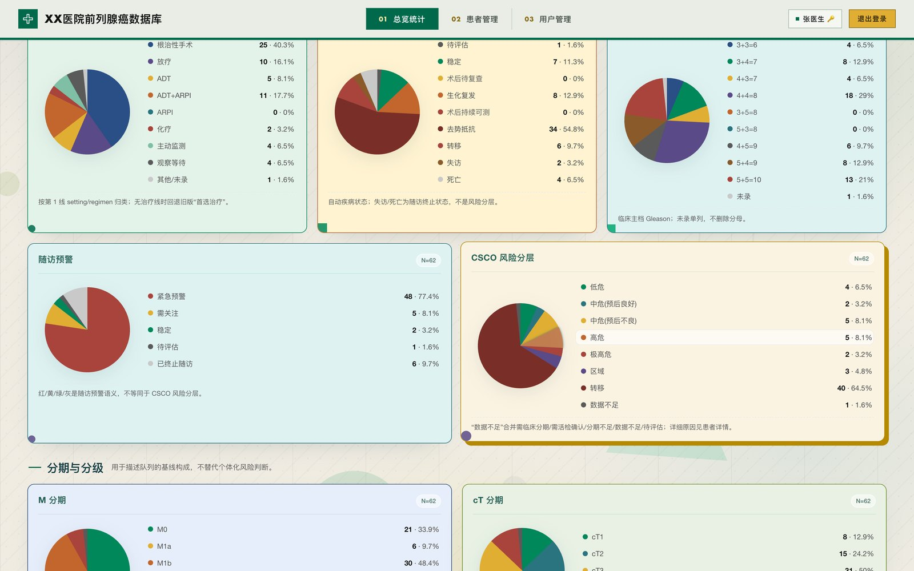 |

总览页把「今日工作台」放在最前：随访到期、睾酮未达去势、CRPC 待判定、M1 未细分、数据待补、核心字段缺失——先处理这些，再看队列统计。

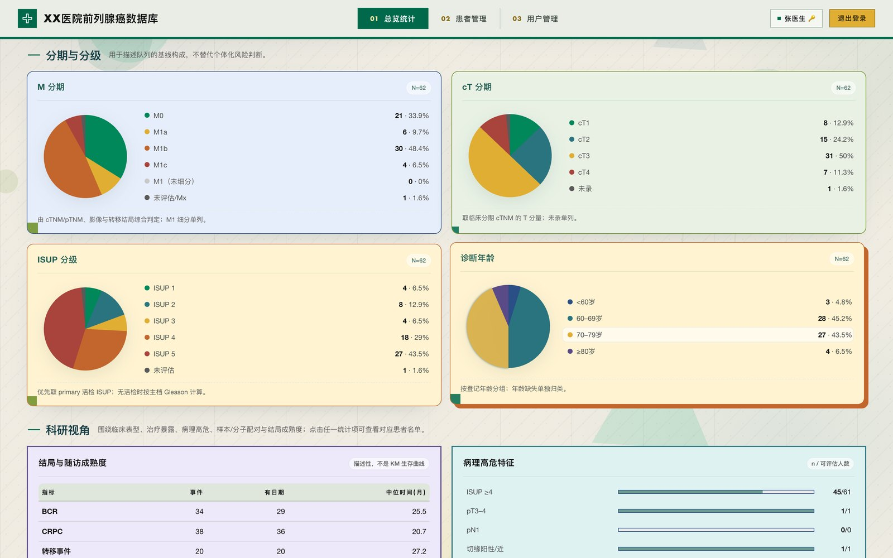

### 患者工作台

左侧患者列表按风险着色（绿=稳定 / 黄=需关注 / 红=紧急预警 / 灰=已终止随访），支持搜索、排序与分页；右侧是读优先的工作台：先看结论，再看记录，按需登记。

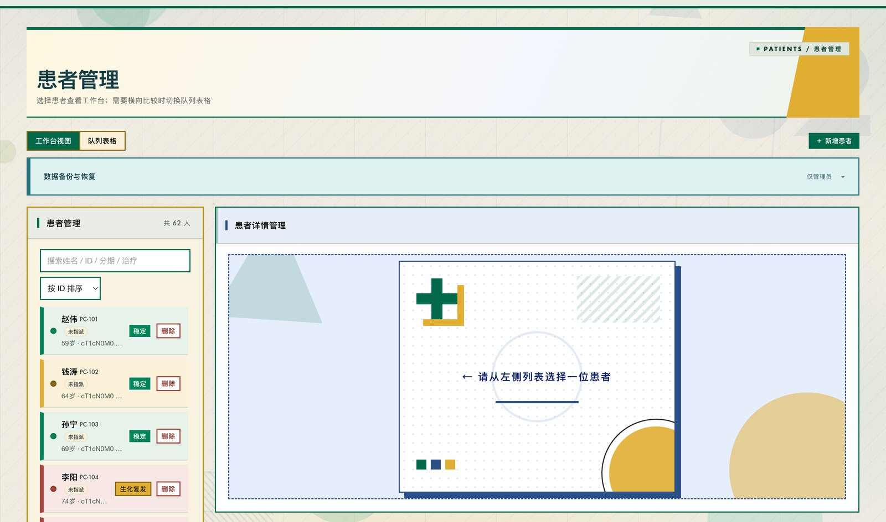

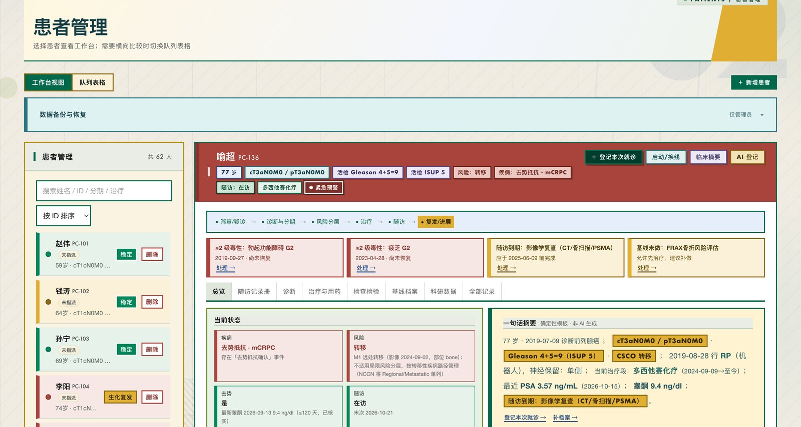

头部徽章按语义分色（年龄 / 分期 / Gleason / ISUP / 风险 / 疾病 / 随访 / 治疗段 / 预警），一眼扫完患者当前状态；下方是诊疗路径、待办提醒与一句话摘要。

### 用药时间轴与化疗周期

一条泳道 = 一个治疗大类，每段说明只占一行，用药再多也不会把时间轴撑高。横向滑动查看完整疗程，支持全程概览缩略图、当前视窗年月徽标、边缘药名吸附。化疗周期在总览默认折叠，标题直接给出「周期数 · 起止 · 减量 n 次 · 延迟 n 次」。

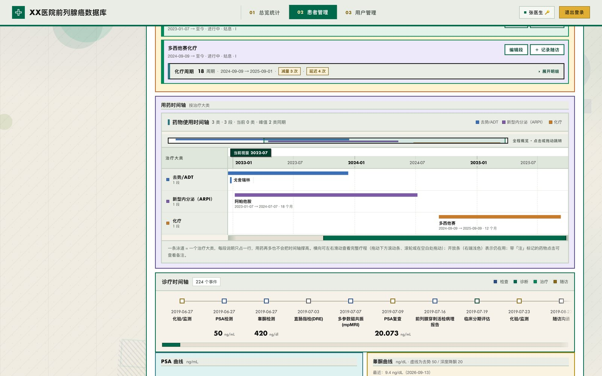

### 指南评估与药物特异性监测

CSCO 2026 指南评估逐条给出「标签 ↔ 结论 ↔ 依据出处」；药物特异性监测按药物毒性谱（PROS-B / PROS-N）列出应查项目与频次，状态分未做 / 已完成 / 异常三态。

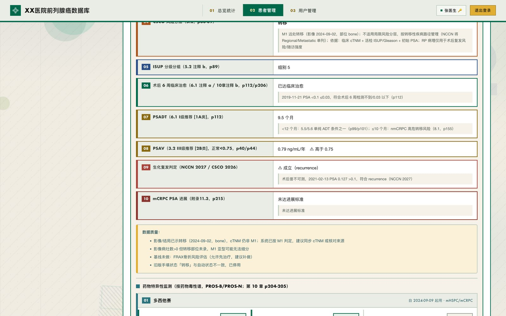

### 随访记录册与治疗用药

治疗段标签选中态为深松绿底白字；连续随访表逐行记录 PSA、睾酮、疗效与毒性。

| 随访记录册 | 治疗与用药 |
|---|---|
| 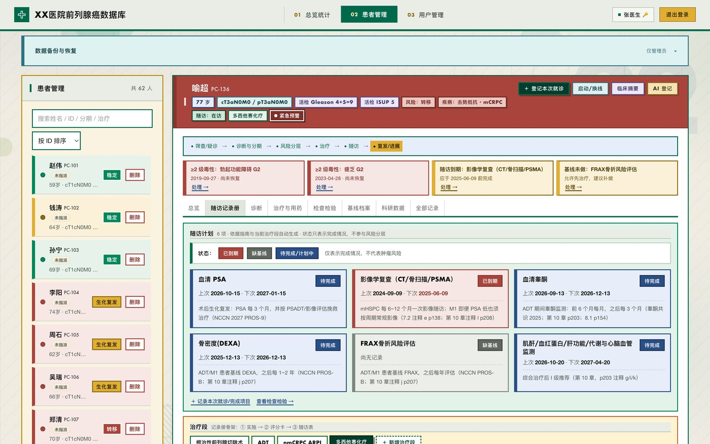 | 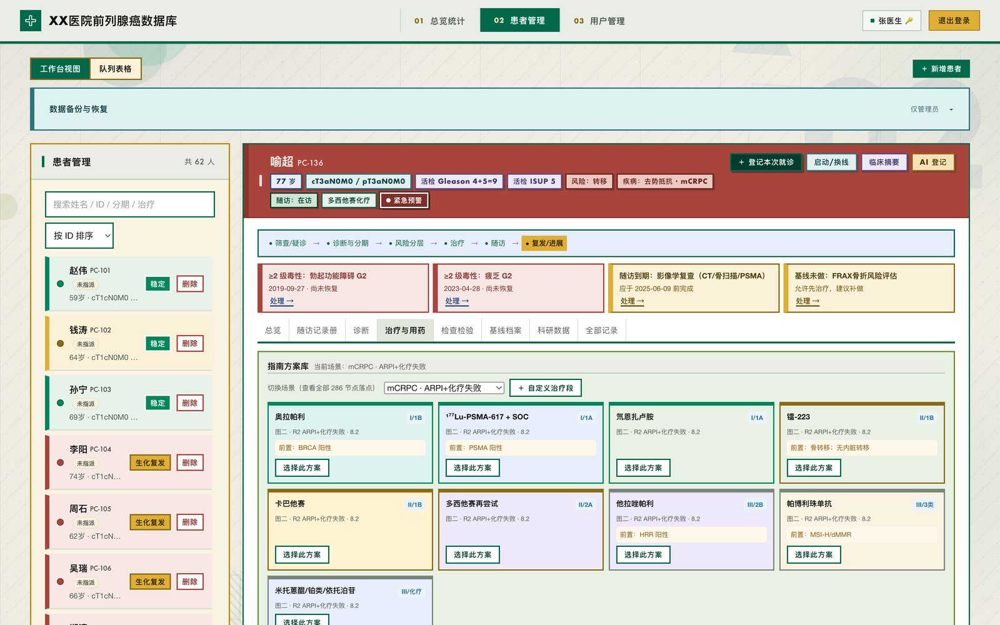 |

### 检验曲线与科研数据

PSA / 睾酮动态曲线带阈值参考线（去势 50 / 深度降酮 20 ng/dl），支持横向滚动查看长病程。

| PSA 与睾酮曲线 | 科研数据与导出 |
|---|---|
| 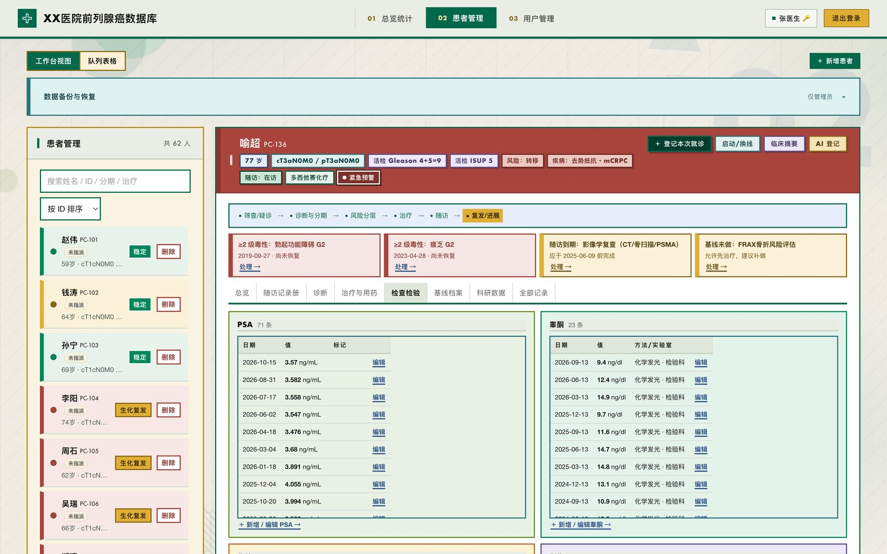 | 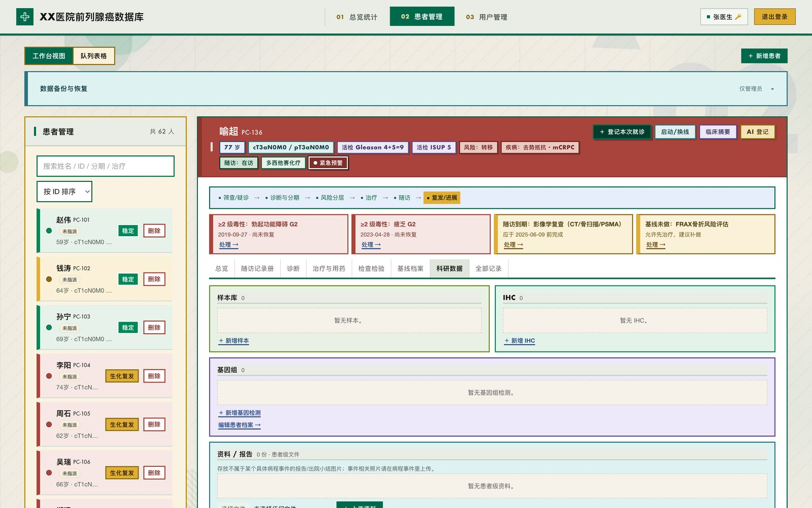 |

### 临床摘要与移动端

临床摘要按九个分区组织（疾病状态 / 当前治疗 / 就诊毒性 / 病理分子 / 结局 / 检验 / 随访 / 合并症 / 数据质量），各带编号与依据，可直接打印。

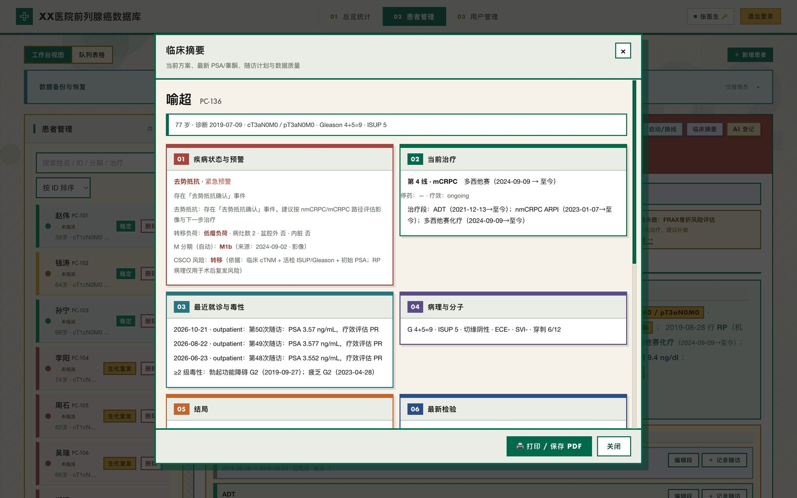

移动端完整可用：窄屏下时间轴提供「整段疗程 / 放大细看」双视图，一屏看全 29 段用药而不必横滚。

| 移动端登录 | 移动端总览 |
|---|---|
| 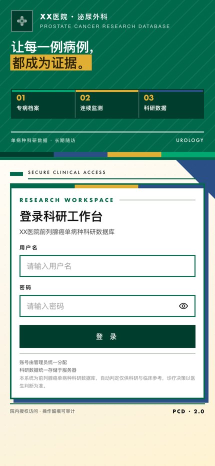 | 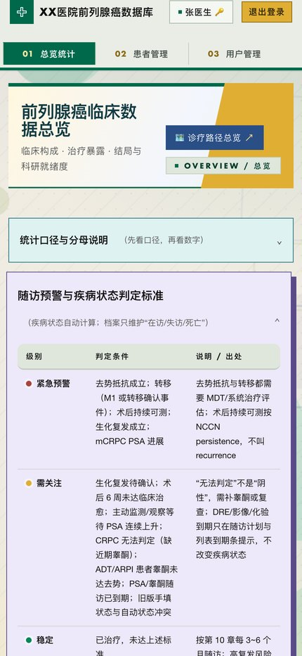 |

## 3. 功能

**患者主档与诊疗全程**

- 患者主档：基本信息、家族史、ECOG、Charlson 合并症、BMI、吸烟史、分期（cT/pT/N/M）、Gleason、ISUP、危险分层
- 多线治疗：根治性手术、放疗、内分泌治疗（ADT / ARPI）、化疗、PARP 抑制剂、核素治疗、骨保护，含起止日期、疗效评估与停药原因
- 治疗段与访视：治疗线 → 治疗段 → 就诊 → 随访行 → 检查项目 / 不良事件，五级结构化关联
- 检查与病理：PSA / 睾酮动态曲线、影像（含三径与体积）、病理（含穿刺针数与阳性率）、IHC、基因检测（HRR / MSI）、标本管理
- 结局事件：生化复发（BCR）、术后持续可测（persistence）、转移、去势抵抗（CRPC）、死亡

**随访工作台**

- 访视计划：按治疗阶段自动生成随访节点，到期 / 逾期提醒
- 访视录入：症状、体能、实验室、影像、治疗调整、不良事件（CTCAE 5.0 分级）
- 用药时间轴：按治疗大类分泳道，全程概览 + 视窗定位 + 边缘吸附，窄屏双视图
- 诊疗时间轴：治疗段、检验、影像、事件统一视图；手术、化疗周期、给药与不良事件自动镜像为节点，删除时同步清理
- 药物特异性监测：按在用药物毒性谱生成应查项目与频次，三态勾选

**科研与数据治理**

- 队列统计：可按治疗方式、分期、Gleason、随访状态等维度切片
- 科研就绪度：核心四层（基线 / 病理 / 治疗 / 随访）完整度逐患者可见
- 导出：tidy CSV（分析就绪）+ ZIP 打包；全库 JSON 备份与恢复（v13 格式，含治疗段等全部结构化对象）
- 审计日志：登录、数据变更、导出行为留痕
- 权限：`admin` 可见全部患者；普通医生仅可见自己创建的患者

**指南知识库**

- 内置 CSCO / NCCN 前列腺癌指南节点目录（4 张流程图、286 个节点）、随访模板与合并症清单，见 [`lib/guideline-catalog.mjs`](lib/guideline-catalog.mjs) 与 [`docs/data-dictionary.md`](docs/data-dictionary.md)
- 指南评估逐条标注推荐等级与出处页码，依据独立成行

**AI 病历登记（可选）**

- 上传病历/报告 → 版面解析 → 字段抽取 → 脱敏 → 医生逐条审核 → 入库
- 默认使用阿里云百炼（DashScope）`qwen3-vl-flash` 做结构化抽取
- **不配置 API Key 时自动进入离线演练模式**，返回结构合法但不联网的示例结果，便于本地验证前后端链路

## 4. 技术栈

| 层 | 选型 | 说明 |
|---|---|---|
| 运行时 | Node.js ≥ 20（ESM） | 开发环境为 Node 24 |
| Web 框架 | Express 4 | 单进程，路由集中在 `server.js` |
| 数据库 | SQLite（better-sqlite3，WAL） | 单文件库，零运维，便于科室内部署 |
| 鉴权 | JWT + bcryptjs | 启动时强制校验密钥强度 |
| 上传 | multer | 病历/报告文件存 `uploads/` |
| 前端 | 原生 HTML/CSS/JS | **无构建步骤**，`public/` 直接静态托管 |
| 主题 | 分层 CSS + 纯装饰 JS | 美术层与业务层解耦，可整体替换 |
| AI | DashScope OpenAI 兼容接口 | 可替换为任意兼容服务 |

设计取舍：单机单进程 + SQLite，是为了让一个科室在一台普通服务器上就能跑起来；如果你要做多中心，建议把数据层换成 PostgreSQL 并前置对象存储。

**美术层解耦**：`construct.css` 加载于所有既有样式之后，只重映射设计令牌与视觉规则；`construct.js` 只注入 `aria-hidden` 装饰节点、不改业务 DOM 与文案。两者可整体移除而不影响任何功能。

## 5. 快速开始

### 前置条件

- Node.js ≥ 20（推荐 24）
- 能编译原生模块的构建工具链（`better-sqlite3` 需要）：
  - macOS：`xcode-select --install`
  - Debian/Ubuntu：`apt install -y build-essential python3`

> 若切换过 Node 大版本后报 `NODE_MODULE_VERSION` 不匹配，执行 `npm rebuild better-sqlite3` 即可。

### 启动

```bash
git clone https://github.com/zhang-zizhong/prostate-cancer-followup.git
cd prostate-cancer-followup
npm install

cp .env.example .env
# 生成一个强密钥填入 JWT_SECRET
openssl rand -hex 32

# 首次启动前，在 .env 里设置管理员账号（仅在空库时生效）
#   INIT_ADMIN_USER=your_admin_name      # 不得为 admin
#   INIT_ADMIN_PASS=<至少 12 位强密码>

npm start
```

打开 <http://127.0.0.1:3000>，用上面创建的管理员账号登录。首次启动会自动建库、建表。

### 造一批演示数据

```bash
# 基础队列：60 例结构化模拟患者，覆盖 15 种临床场景
python3 scripts/generate-test-cohort.py

# 高密度队列：在既有病程骨架上加密随访、检验、给药与毒性记录
# 平均约 1000 条/人，用于演示长病程多线治疗的完整数据形态
python3 scripts/enrich-cohort.py
```

生成的 JSON 为 v13 备份格式，在「患者管理 → 数据备份与恢复」中导入即可。两个脚本都是**离线生成**，不联网、不触碰运行中的数据库。

`enrich-cohort.py` 的设计原则：不另起剧情，只在患者自己的分期、治疗与转归时间轴上填补空隙；新增 PSA 按既有轨迹对数插值；死亡 / 失访患者不越过其终点日期；并自行遵守后端的枚举与用药冲突约束（导入直插库会绕过 API 校验）。

### 开发模式

```bash
npm run dev     # node --watch，改完自动重启
```

## 6. 环境变量

完整示例见 [`.env.example`](.env.example)。

| 变量 | 必填 | 默认值 | 说明 |
|---|---|---|---|
| `JWT_SECRET` | ✅ | — | ≥32 位随机串，过弱会拒绝启动 |
| `INIT_ADMIN_USER` / `INIT_ADMIN_PASS` | 首次 | — | 仅在空库时创建管理员 |
| `PORT` | | `3000` | 监听端口 |
| `HOST` | | `127.0.0.1` | 对外部署改为 `0.0.0.0` |
| `APP_TZ` | | `Asia/Shanghai` | 随访日期计算时区 |
| `DATA_DIR` / `DB_FILE` / `UPLOAD_DIR` | | 项目内 | 存储路径 |
| `DASHSCOPE_API_KEY` | | 空 | 留空则 AI 登记进入离线演练模式 |
| `AI_MODEL_EXTRACT` | | `qwen3-vl-flash` | 抽取模型 |
| `AI_MODEL_REDACT` | | `qwen-turbo` | 脱敏模型 |
| `AI_INTAKE_ENABLED` | | `true` | 设为 `false` 关闭 AI 入口 |

## 7. 目录结构

```
.
├── server.js                 # 入口：Express 路由、鉴权、业务逻辑
├── lib/
│   ├── ai-client.mjs         # DashScope 调用、重试、离线模式
│   ├── ai-intake.mjs         # AI 登记流水线
│   ├── ai-prompt.mjs         # 提示词与药品分类
│   ├── guideline-catalog.mjs # 指南节点/模板/合并症目录
│   ├── lab-catalog.mjs       # 检验项目字典与单位换算
│   └── visit-rules.mjs       # 访视、治疗段、不良事件的校验规则
├── public/                   # 无构建前端
│   ├── index.html            # 主界面（总览/患者/用户管理）
│   ├── workspace.js          # 患者工作台（读优先，8 个页签）
│   ├── clinical-core.js      # 临床计算（BCR、CRPC、风险分层、PSA 动力学）
│   ├── record-core.js        # 记录册逻辑
│   ├── cohort-core.js        # 队列统计
│   ├── export-core.js        # CSV / ZIP 导出
│   ├── workbench-labels.js   # 字段中文标签字典
│   ├── ai-intake-ui.js       # AI 登记审核界面
│   ├── construct.css         # 松绿构成主题层（纯美术，可整体移除）
│   ├── construct.js          # 装饰层（aria-hidden 节点，不改业务 DOM）
│   └── guideline-pathway.html# 指南路径图独立页
├── scripts/
│   ├── generate-test-cohort.py  # 基础演示队列生成
│   ├── enrich-cohort.py         # 高密度演示队列生成
│   ├── test-*.mjs               # 单测与集成测试
│   └── check-frontend.mjs       # 前端轻量自检
├── docs/                     # 架构与数据字典
├── screenshots/readme/       # 本文档使用的界面截图（测试数据）
└── data/  uploads/           # 运行时数据（已 gitignore）
```

## 8. 数据模型与文档

- [数据字典](docs/data-dictionary.md)：患者、病理、影像、放疗、结局等对象与字段口径
- [数据字典 v13 增补](docs/data-dictionary-v13.md)：治疗段、访视、访视行、不良事件、化疗周期、疾病状态
- [架构说明](docs/architecture.md)：请求链路、鉴权、数据分层、AI 登记流水线、已知限制

## 9. 测试

```bash
npm test
```

**102 项单测 + 2 个集成脚本**，覆盖：

- `test-clinical-logic.mjs`：BCR、CRPC、危险分层、PSA 动力学、去势判定、骨髓抑制分级
- `test-visit-rules.mjs`：访视 / 治疗段 / 不良事件校验与分级
- `test-record-core.mjs` / `test-cohort-core.mjs` / `test-export-core.mjs`：记录册、队列统计、CSV/ZIP 导出
- `test-guideline-catalog.mjs`：指南目录完整性（4 张图 / 286 节点）
- `test-ai-warnings.mjs`、`test-ai-intake-fixes.mjs`：AI 登记告警与离线链路
- `test-structured-api.mjs`：结构化接口端到端

前端还有轻量自检：

```bash
node scripts/check-frontend.mjs
```

## 10. 部署

单机部署的典型形态：

```
Nginx (TLS) → Node (127.0.0.1:3000) → SQLite 文件
```

要点：

1. `HOST=127.0.0.1`，只让反向代理访问；Nginx 配置 `client_max_body_size`（上传病历）与 `proxy_read_timeout`（AI 抽取耗时较长）。
2. `.env` 权限设为 `600`，`JWT_SECRET` 用 `openssl rand -hex 32` 生成。
3. `data/` 与 `uploads/` 定期冷备，备份文件加密后再落盘或上传。数据库处于 WAL 模式，热备请用 `VACUUM INTO` 生成一致性快照，不要直接复制 `.db` 文件。
4. 用 systemd / pm2 守护进程，日志单独归档。
5. 对公网开放前，请先完成等保与个人信息保护影响评估。

> 仓库中的 `scripts/deploy.sh`、`setup-ssh.sh` 等运维脚本因含真实服务器地址，未包含在开源版本中。

## 11. 贡献

欢迎 Issue 与 PR，尤其是：

- 指南更新（CSCO / NCCN / EAU 新版节点）
- 随访规则与判定口径的修正
- 多中心部署、PostgreSQL 适配
- 英文文档与国际化

请先读 [CONTRIBUTING.md](CONTRIBUTING.md)。**任何 PR 都不得包含真实患者数据**；测试请使用 `scripts/generate-test-cohort.py` 生成的模拟数据。

<a id="author"></a>

## 12. 作者与许可

**作者：张子众（Zhang Zizhong）**

本项目的全部代码与文档由张子众个人独立完成，使用个人设备与个人时间开发，**不隶属于任何公司、医院、高校或其他机构，不属于职务作品**。

**Copyright © 2026 张子众（Zhang Zizhong）**

以 [Apache License 2.0](LICENSE) 发布，完整的版权与第三方声明见 [NOTICE](NOTICE)。Apache-2.0 允许商业使用、修改与闭源分发，但要求保留版权声明与许可证副本、标注修改过的文件，并且**不得使用作者姓名或项目名称为衍生作品背书**（第 6 条）。

如果你在论文、标书或产品中使用了本项目的代码或设计，欢迎按 [CITATION.cff](CITATION.cff) 引用，或在致谢中注明项目地址。

---

<details>
<summary>English</summary>

A single-disease follow-up and research database for prostate cancer, built with Node.js, Express and SQLite, with a no-build vanilla JS frontend.

It covers the full care pathway: baseline staging and pathology, radical prostatectomy / radiotherapy / ADT and later-line therapy, structured follow-up visits with reminders, PSA and testosterone kinetics, BCR / persistence / CRPC / metastasis determination, medication timelines by treatment class, drug-specific toxicity monitoring, cohort statistics, research-readiness scoring, tidy CSV export and JSON backup, audit logging, role-based access, and an optional LLM-based clinical-note intake pipeline with a fully offline mock mode.

The UI follows a "pine-green constructivist" visual language — Swiss grid order crossed with constructivist colour blocks: hard right angles, flat primaries, numbered indices and a visible baseline grid. The theme layer (`construct.css` / `construct.js`) is fully decoupled from business logic and can be removed without affecting any feature.

Three-state semantics run through the whole schema: `NULL` = not assessed, `0` = assessed negative, `1` = positive. "Not assessed" is never counted as negative.

**Not a medical device.** No clinical validation has been performed. All automated determinations are for research and clinical reference only. Never commit real patient data.

Licensed under the Apache License 2.0.

</details>